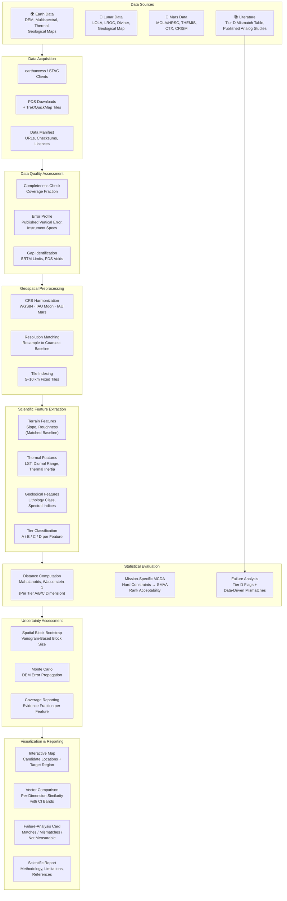

# Technical Architecture

**Proposed System Architecture for Terrain Intelligence**

> [!IMPORTANT]
> This document describes a **proposed** architecture. No system has been implemented. The architecture will be refined and built during the hackathon event.

---

## Conceptual Data Flow



---

## Technology Stack

### Core Libraries

| Layer | Libraries | Purpose |
|-------|-----------|---------|
| **Data Access** | earthaccess, requests, pystac | Download and discover datasets |
| **Raster Processing** | rasterio, rioxarray, xarray | Read, reproject, resample rasters |
| **Vector Processing** | geopandas, shapely | Site boundaries, geological maps |
| **CRS Management** | pyproj | Planetary and terrestrial coordinate systems |
| **Numerical** | numpy, scipy | Array operations, statistical functions |
| **Statistical** | scikit-learn, scipy.stats | Distances, clustering, distributions |
| **Visualization** | plotly, pydeck, matplotlib | Interactive maps, charts, static figures |
| **Application** | streamlit | Dashboard interface |
| **Development** | jupyterlab, flake8, black | Interactive development, code quality |

### Potential Additional Libraries (Evaluate During Hackathon)

| Library | Purpose | Risk |
|---------|---------|------|
| WhiteboxTools or xdem | Terrain derivatives (slope, roughness, curvature) | Verify Python bindings and compatibility [verify] |
| PySAL | Spatial statistics (variograms, spatial autocorrelation) | Large dependency; may only need specific subpackages |
| earthaccess | NASA Earthdata authentication and search | Test during prep to verify API access |

---

## Module Structure (Proposed)

```
src/
├── data/
│   ├── acquire.py          # Download and cache datasets
│   ├── manifest.py         # Dataset registry with URLs and checksums
│   └── validate.py         # Completeness and quality checks
│
├── preprocessing/
│   ├── crs.py              # CRS definitions (WGS84, IAU Moon, IAU Mars)
│   ├── resample.py         # Resolution matching to common baseline
│   └── tiling.py           # Fixed-tile index generation
│
├── features/
│   ├── terrain.py          # Slope, roughness at matched baselines
│   ├── thermal.py          # LST statistics, thermal inertia
│   ├── geology.py          # Lithology classification, spectral indices
│   └── tiers.py            # Tier A/B/C/D classification per feature
│
├── analysis/
│   ├── distance.py         # Mahalanobis, Wasserstein, energy distance
│   ├── mcda.py             # Constraints, SMAA, rank acceptability
│   ├── failure.py          # Failure-analysis card generation
│   └── uncertainty.py      # Block bootstrap, MC error propagation
│
├── visualization/
│   ├── map_view.py         # Interactive map (Plotly/PyDeck)
│   ├── comparison.py       # Vector comparison charts
│   └── cards.py            # Failure-analysis card rendering
│
└── app/
    └── dashboard.py        # Streamlit application entry point
```

> [!NOTE]
> This module structure is a starting point. It will evolve during the hackathon based on actual implementation needs.

---

## Data Flow Principles

1. **Immutable raw data**: Downloaded data is never modified in place. All transformations produce new files.
2. **Reproducible pipeline**: Every step from raw data to output should be repeatable from the data manifest.
3. **Pre-computation**: The Streamlit app serves pre-computed results. No heavy computation at render time.
4. **Explicit CRS**: Every raster and vector dataset must carry explicit CRS metadata. No implicit assumptions.

---

## Deployment Model (Hackathon)

- **Local development**: Jupyter notebooks for exploration → Python modules for pipeline
- **Demo**: Streamlit app running locally or deployed to Streamlit Cloud
- **No heavy backend**: Pre-compute everything; the app is a viewer, not a compute engine

---

*Document status: Proposed architecture. Not implemented. Subject to change during the hackathon.*
